# Cycle Superstore Analytics Platform

[](https://github.com/cyclesuperstore/cycle-superstore-analytics/actions/workflows/build-dwh-dev.yml)
[](https://github.com/cyclesuperstore/cycle-superstore-analytics/actions/workflows/deploy-dwh-prod.yml)


Enterprise analytics engineering platform for Cycle Superstore — a governed, layered Azure SQL data warehouse orchestrated by Azure Data Factory and served through a Power BI PBIP semantic layer.

## Stack

| Layer | Technology |
|---|---|
| Orchestration | Azure Data Factory (ADF) |
| Warehouse | Azure SQL Database, managed as an SSDT SQL Database Project (`Microsoft.Build.Sql` SDK) |
| Semantic / Reporting | Power BI, PBIP (Power BI Project) format, thin reports |
| CI/CD | GitHub Actions (OIDC federated auth to Azure, no stored credentials) |

## Architecture at a Glance

```mermaid
flowchart LR
    subgraph SRC["Source Systems"]
        direction TB
        S1[CCData ERP]
        S2[CSS2 / POS]
        S3[Google Ads]
        S4[Microsoft 365]
    end

    subgraph ADF["Azure Data Factory"]
        direction TB
        P1[Ingestion Pipelines]
    end

    subgraph DWH["Azure SQL — css-dwh-project"]
        direction TB
        BRONZE["Bronze<br/>raw_ccdata / raw_css2 / raw_google / raw_365<br/>(tables/01_bronze)"]
        SILVER["Silver<br/>stg schema<br/>(views/01_silver)"]
        INT["Intermediate<br/>int schema<br/>(views/02_intermediate)"]
        GOLD["Gold<br/>marts schema — facts & dimensions<br/>(views/03_gold)"]
        SEM["Semantic Views<br/>dbo schema<br/>(views/04_semantic)"]
        BRONZE --> SILVER --> INT --> GOLD --> SEM
    end

    subgraph PBI["Power BI"]
        direction TB
        MODEL["Semantic Models<br/>power_bi/semantic_models/main, curated"]
        THIN["Thin Reports<br/>order_detail, service, products, ..."]
        MODEL --> THIN
    end

    SRC --> ADF --> BRONZE
    SEM --> MODEL
```



Full column-level lineage (auto-generated) lives in [docs/warehouse_lineage_context.mmd](docs/warehouse_lineage_context.mmd) and as rendered diagrams in [data_platform/warehouse_lineage/](data_platform/warehouse_lineage/).

## Prerequisites & Local Environment Setup

| Tool | Version | Purpose |
|---|---|---|
| [.NET SDK](https://dotnet.microsoft.com/download) | 8.0.x | Builds the SQL Database Project (`dotnet build`) via the `Microsoft.Build.Sql` SDK |
| [Graphviz](https://graphviz.org/download/) | latest | Renders lineage DOT files to SVG/PNG (`dot.exe` must be on PATH) |
| [VS Code](https://code.visualstudio.com/) | latest | Primary editor |
| VS Code extension — SQL Database Projects | latest | Edit/build/publish `css-dwh-project/` |
| VS Code extension — Power BI (PBIP tooling) | latest | Edit semantic models and thin reports |
| [PowerShell](https://github.com/PowerShell/PowerShell) | 7+ | Runs ops scripts and the lineage generator |
| [SqlPackage](https://learn.microsoft.com/sql/tools/sqlpackage/sqlpackage) | latest | Publishes the compiled `.dacpac` to Azure SQL (installed automatically in CI) |

Compile the database project locally:

```powershell
dotnet build css-dwh-project/
```

This produces `css-dwh-project/bin/Debug/css-dwh-project.dacpac` (or `bin/Release/...` with `-c Release`).

## Repository Directory Guide

| Path | Function | Asset Type |
|---|---|---|
| `css-dwh-project/` | Canonical warehouse source of truth — schemas, tables, views (bronze → silver → intermediate → gold → semantic), procedures, functions, security | SSDT SQL Database Project (`.sqlproj`, `.sql`) |
| `data_platform/adf/` | Azure Data Factory pipelines, datasets, linked services, triggers, integration runtimes | ADF ARM-style JSON artifacts |
| `data_platform/ops/` | Operational execution scripts for manual fact/dim reloads and utility runs | `.sql` runbook scripts |
| `data_platform/admin/` | Reviewed security and environment administration scripts awaiting manual execution | `.sql` administration scripts |
| `data_platform/scripts/maintenance/` | Reviewed exceptional data and schema migration scripts awaiting manual execution | `.sql` maintenance scripts |
| `data_platform/tests/` | Platform-level database test harness | PowerShell + `.sql` |
| `data_platform/warehouse_lineage/` | Lineage generator scripts and rendered lineage diagrams | PowerShell, DOT, SVG/PNG/HTML |
| `power_bi/` | PBIP semantic models, thin reports, Tabular Editor scripts, themes | PBIP / TMDL |
| `docs/` | Architecture history, MCP/tooling setup notes, AI-readable lineage context | Markdown, Mermaid (`.mmd`) |
| `ad_hoc/sql/` | Ad hoc investigative and diagnostic SQL | `.sql` scripts |

## Branching & Deployment Strategy

| Branch | Purpose | Trigger |
|---|---|---|
| `dev` | Active development; deploys to the `css-dwh-dev` Azure SQL database and dev Power BI workspace | Push to `dev` builds the SQL project ([build-dwh-dev.yml](.github/workflows/build-dwh-dev.yml)) |
| `main` | Production; automated release branch | Push to `main` builds and publishes the `.dacpac` to `css-dwh-prod` via OIDC ([deploy-dwh-prod.yml](.github/workflows/deploy-dwh-prod.yml)) |

### CI/CD Quality Gates

* **PR compilation** — every change under `css-dwh-project/` must build cleanly with `dotnet build` before merge ([build-dwh-dev.yml](.github/workflows/build-dwh-dev.yml)).
* **Database validation** — a manually-triggered workflow publishes the project to a disposable `css-dwh-test` database, seeds it, runs the load procedures, and validates results end-to-end ([test-dwh-database.yml](.github/workflows/test-dwh-database.yml)).
* **Production deploys** authenticate to Azure via OIDC (no stored SQL credentials) and publish the `Release` `.dacpac` with `sqlpackage` ([deploy-dwh-prod.yml](.github/workflows/deploy-dwh-prod.yml)).

## Developer Runbook

### Build the `.dacpac` locally

```powershell
dotnet build css-dwh-project/css-dwh-project.sqlproj -c Release
```

Output: `css-dwh-project/bin/Release/css-dwh-project.dacpac`. Use the VS Code task **sqlproj: Build css-dwh-project** to run this from the editor.

### Run the database test suite

Use the VS Code task **database tests: run css-dwh-test**, or run directly:

```powershell
./data_platform/tests/run_database_tests.ps1 -ServerName <server> -ResetConfirmation "RESET css-dwh-test" -Publish
```

### Regenerate warehouse lineage diagrams

```powershell
./data_platform/warehouse_lineage/render_lineage_svg.ps1
```

Also available as the VS Code task **lineage: generate warehouse diagram**. This refreshes the DOT/SVG/PNG/HTML outputs in `data_platform/warehouse_lineage/` and the AI-readable Mermaid context in [docs/warehouse_lineage_context.mmd](docs/warehouse_lineage_context.mmd).

### Working with Power BI thin reports

See [power_bi/README.md](power_bi/README.md) for the semantic model structure, table numbering convention, and thin-report binding workflow via ALM Toolkit.
